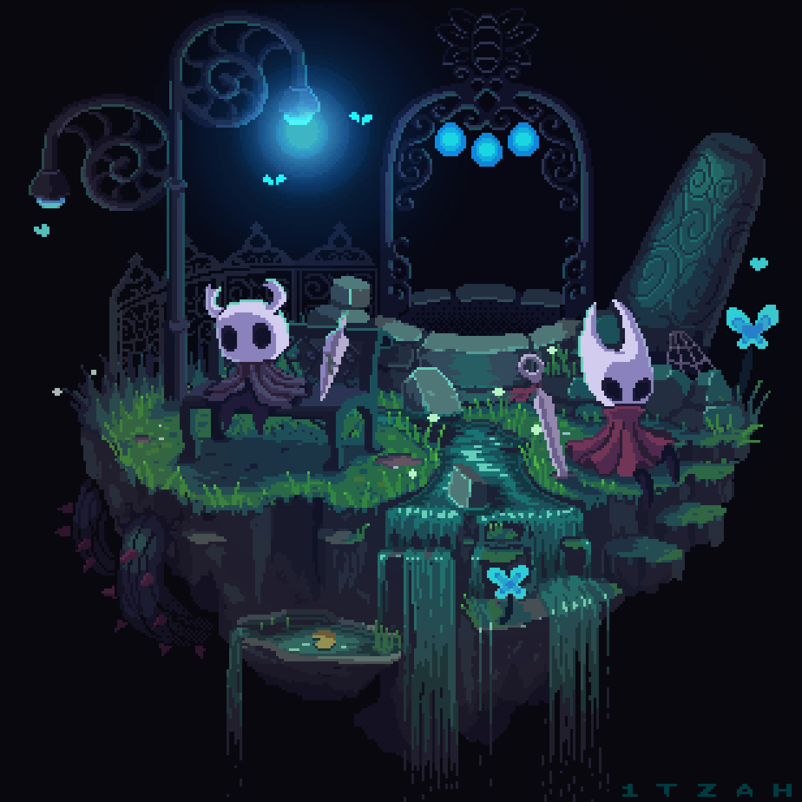
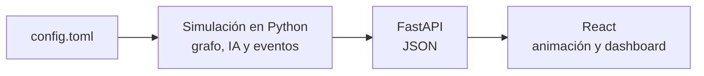

# 🧟 Zombie Survival Engine

### Simulación de persecución sobre grafos · Matemática Discreta & QA Framework

[](https://github.com/HugoGALAGA/proyecto_mate_discreta/actions/workflows/qa-pipeline.yml)




Proyecto académico de **Matemática Discreta** construido bajo la metodología **Shift-Left QA**, **Integración Continua** y principios **ISTQB**. Un zombie persigue a un grupo de supervivientes por un mapa modelado como **grafo ponderado**, y todo el comportamiento emerge de algoritmos de grafos y reglas discretas.

> 🚧 **Estado:** entorno de QA, CI y contrato de la API listos. La lógica del juego está en desarrollo.

---

## 🎮 1. La idea

- Un mapa de **30 a 35 nodos** (red de mundo pequeño) con **una única Zona Segura (ZS)**.
- **3 a 5 supervivientes** intentan llegar a la ZS; **1 zombie** los caza y convierte en zombies a quienes atrapa.
- Los nodos vecinos de la ZS (**LS**) son zonas **semi seguras**: si un zombie y un superviviente coinciden allí, 50/50 de que el superviviente se salve (o quede **amputado**) o muera.
- Si se agota el tiempo, los supervivientes restantes son **Carroñeros** y reciben un final absurdo.
- Al terminar, un **dashboard** muestra estadísticas por entidad y, por cada captura, el **MST** (Prim) con el **camino de Dijkstra** resaltado.

**Matemática discreta en acción:** grafos ponderados · grado y conexidad · redes small-world · Dijkstra · Prim (MST) · colas de prioridad · simulación por eventos discretos · probabilidad.



La simulación se calcula **completa y de forma determinista** (misma semilla, misma partida) y el frontend **reproduce** el registro de eventos.

---

## 🧰 2. Stack

| Capa | Herramientas |
|---|---|
| Lenguaje | Python 3.11 |
| Entorno y dependencias | `uv` (`pyproject.toml` + `uv.lock`) |
| Backend | FastAPI + uvicorn |
| Frontend | React 18 + Vite 5 (JavaScript) |
| Calidad estática | `ruff` (lint y formato), ESLint 9 |
| Pruebas | pytest, pytest-cov, Hypothesis, Playwright |
| CI / CD | GitHub Actions (gate rápido) · Jenkins (pipeline completo) |

**Fast Tooling (Stack en Rust):** `uv` y `ruff` están escritos en Rust, lo que mantiene instalación y análisis estático ultrarrápidos.

---

## 🚀 3. Inicio rápido

Requisitos: `uv` y Node.js 24. Desde la raíz del repo:

```bash
# Instalar dependencias
uv sync --group dev
cd frontend; npm install; cd ..

# Calidad y pruebas (unit + integration)
uv run ruff check .
uv run pytest --cov=src --cov-fail-under=80

# Desarrollo (dos terminales)
uv run uvicorn src.api.app:app --reload --port 8000
cd frontend; npm run dev

# Pruebas E2E (una vez: playwright install chromium)
cd frontend; npm run build; cd ..
uv run pytest tests/e2e -m e2e
```

---

## 🛠️ 4. Estructura del repositorio

```text
proyecto_mate_discreta/
├── .github/workflows/qa-pipeline.yml   # GitHub Actions: gate rápido
├── Jenkinsfile                         # Pipeline completo con E2E
├── config.toml                         # Todos los parámetros del juego
├── pyproject.toml                      # Dependencias y herramientas
├── docs/                               # Diseño, contrato de la API y plan de pruebas
├── src/                                # Núcleo en Python
│   ├── graph/                          #   Mapa, Dijkstra, Prim, layout
│   ├── sim/                            #   Entidades, IA, reglas y motor de eventos
│   ├── stats/                          #   Registro de eventos y estadísticas
│   ├── data/                           #   Finales de Carroñero y amputaciones
│   └── api/                            #   FastAPI (contrato JSON)
├── frontend/                           # React + Vite (menú, partida, dashboard)
└── tests/
    ├── unit/                           #   Grafo, algoritmos y reglas
    ├── integration/                    #   Partidas con semilla fija y API
    └── e2e/                            #   Playwright sobre el servidor real
```

---

## 🧪 5. Calidad y CI/CD

- **Shift-Left:** `pre-commit` (ruff) antes de cada commit y gate en cada push.
- **Quality Gates:** el CI bloquea la fusión si falla el lint o la cobertura baja de **80%**.
- **TDD:** ciclo *Red-Green-Refactor*; cada módulo llega con sus tests.
- **Tres niveles de prueba:** unit (con **Hypothesis** para propiedades), integration y e2e.
- **Determinismo:** una semilla inyectable hace reproducible cualquier partida, clave para CI.

| Pipeline | Qué corre |
|---|---|
| **GitHub Actions** | ruff · unit + integration con cobertura · ESLint · build de React |
| **Jenkins** | todo lo anterior + E2E con Playwright, reporte HTML, JUnit y capturas |

---

## 🌿 6. Flujo de trabajo

`dev` (trabajo diario) → push → checks en verde → **Pull Request** → `main`. `main` solo recibe cambios por PR.

---

## 📚 7. Documentación

| Documento | Contenido |
|---|---|
| [`docs/game-design.md`](docs/game-design.md) | Reglas completas del juego |
| [`docs/estructura-y-flujo.md`](docs/estructura-y-flujo.md) | Estructura, reglas del código y flujo de trabajo |
| [`docs/contrato-api.md`](docs/contrato-api.md) | Formato JSON de la API (v1) |
| [`docs/test-plan.md`](docs/test-plan.md) · [`docs/test-cases.md`](docs/test-cases.md) | Estrategia y casos de prueba |

---

## 🗺️ 8. Hoja de ruta

- [x] Entorno: uv, FastAPI, React + Vite
- [x] CI con GitHub Actions y E2E con Playwright
- [x] Diseño del juego y contrato de la API
- [ ] Mapa: generador, validador, Dijkstra, Prim y layout
- [ ] Simulación: IA, reglas y motor de eventos
- [ ] API del contrato y frontend (menú, partida, dashboard)
- [ ] Pipeline de Jenkins configurado

---

**Autor:** Hugo ([@HugoGALAGA](https://github.com/HugoGALAGA)) 